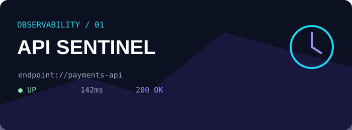
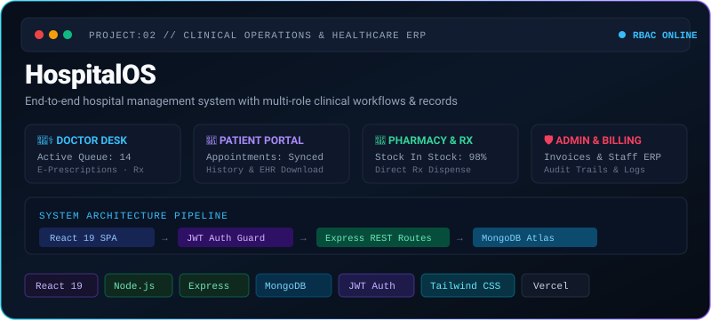
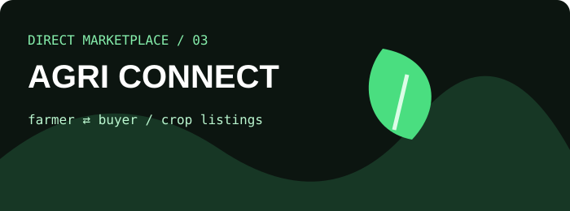
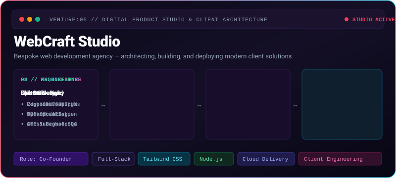

Software engineering · Backend systems · Full-stack products ·
Applied AI

01 / The person behind the code
I’m Sarthak Tanpure, a third-year Information Technology engineering
student at Pravara Rural Engineering College. I enjoy understanding
how software works beneath the interface — from API design and data
modeling to storage behavior and applied machine learning.

I learn by building: turning ideas into working applications, exploring
engineering trade-offs, and improving systems through testing and
iteration.
- Currently focused on: Java, backend engineering, system design
  fundamentals, and applied AI.
- Problem solving: 200+ Data Structures & Algorithms problems solved
  in Java.
- Building beyond coursework: Co-founder at WebCraft
  Studio, contributing to
  technical architecture and client delivery.
- Looking for: Software Development Engineer internships, backend
  opportunities, and meaningful engineering collaborations.

<strong>A little more about how I think</strong>

Principle	What it means in practice
Understand the system	Learn the path from request to application logic, storage, and response.
Correctness before claims	Test behavior, investigate edge cases, and measure before reporting results.
Build for real users	Prefer useful workflows and maintainable features over technology for its own sake.
Keep learning	Strengthen fundamentals while exploring systems and applied AI.

02 / The toolkit

<table>
<thead>
<tr>
<th align="left">
Area
</th>
<th align="left">
Technologies & concepts
</th>
</tr>
</thead>
<tbody>
<tr>
<td>
<strong>Languages</strong>
</td>
<td>
Java · Python · JavaScript (ES6+) · TypeScript
</td>
</tr>
<tr>
<td>
<strong>Backend</strong>
</td>
<td>
Node.js · Express.js · FastAPI · REST APIs · JWT authentication
</td>
</tr>
<tr>
<td>
<strong>Frontend</strong>
</td>
<td>
React · Vite · Tailwind CSS · Responsive UI
</td>
</tr>
<tr>
<td>
<strong>Data</strong>
</td>
<td>
MongoDB · Mongoose · Redis (fundamentals) · Schema design · Indexing
</td>
</tr>
<tr>
<td>
<strong>Applied AI</strong>
</td>
<td>
PyTorch · CNNs · Grad-CAM · OpenCV · RAG fundamentals · Embeddings
</td>
</tr>
<tr>
<td>
<strong>Engineering</strong>
</td>
<td>
DSA · OOP · RBAC · JUnit · API testing · Git · GitHub Actions · Vercel ·
Render
</td>
</tr>
<tr>
<td>
<strong>Exploring</strong>
</td>
<td>
LSM-Trees · WAL · SSTables · Bloom filters · Compaction · Vector
retrieval
</td>
</tr>
</tbody>
</table>03 / Selected work
I like projects that solve a concrete problem and offer room to explore
the engineering underneath. Here are a few builds across backend
systems, full-stack development, and applied AI.

01 — API Sentinel
API monitoring & reliability platform

A full-stack platform for registering API endpoints, running health
checks, measuring response times, and reviewing historical monitoring
results.
- Built endpoint management and health-check workflows using Node.js,
  Express, and Axios.
- Captured HTTP status codes, response times, and check outcomes, with
  results persisted in MongoDB.
- Developed a React dashboard for viewing endpoint status and
  monitoring history.
<strong>Stack:</strong> React · Node.js · Express · MongoDB ·
Mongoose · Axios

02 — HospitalOS
Hospital operations & management platform

A role-based hospital management platform designed to bring patient,
staff, appointment, and operational workflows into one application.
- Developed role-based workflows with JWT authentication and
  authorization for different hospital user types.
- Built modules for patient records, appointments, doctors, invoices,
  medicines, laboratory workflows, and communication.
- Used MongoDB and Redis to support application data and real-time
  features.
<strong>Stack:</strong> React · Node.js · Express · MongoDB · Redis
· JWT

03 — AgriConnect
Agricultural marketplace

A marketplace connecting farmers and buyers through digital produce
listings, discovery, and transaction-oriented workflows.
- Built farmer listing and buyer discovery flows using React and
  Express.
- Implemented authentication and data persistence with JWT and
  MongoDB.
- Integrated payment and real-time interaction workflows using
  Razorpay and Socket.IO.
<strong>Stack:</strong> React · Vite · Tailwind CSS · Node.js ·
Express · MongoDB · Razorpay · Socket.IO

04 — MediVision AI
Medical imaging & explainable AI

An applied computer-vision project exploring medical-image
classification and visual explanations to help users inspect model
predictions.
- Developed a CNN-based image classification workflow for chest
  X-ray images.
- Used Grad-CAM to produce visual heatmaps that help interpret
  regions influencing model predictions.
- Combined a React application with a FastAPI inference service,
  including an upload-later workflow for low-connectivity environments.
<strong>Stack:</strong> Python · PyTorch · FastAPI · React · CNN ·
Grad-CAM

05 — WebCraft Studio
Digital product & web development venture · Co-founder

A web development studio working with clients to translate business
requirements into polished, practical web experiences.
- Contribute to technical architecture, requirement gathering, and
  implementation planning.
- Work across responsive frontend development, backend integration, and
  deployment.
- Collaborate on client delivery and ongoing product improvements.
<strong>Focus:</strong> Product thinking · Full-stack development ·
Client engineering · Deployment

<strong>More projects & explorations</strong>

Project	What it explores	Link
LSMTreeDB	Java-based log-structured key-value storage engine; exploring WAL, memtables, SSTables, and compaction.	Repository
ResearchPilot	Document research assistant exploring RAG, semantic retrieval, and citation-grounded answers.	Repository
MedGuardAI	Offline-oriented medicine verification and provenance concept developed for a hackathon.	Repository
AscendOS	Personal career and learning management application.	Repository

04 / The problem-solving habit

 

Stats are provided by third-party services and may occasionally be
unavailable or delayed.
05 / Current learning track
FOCUS
├── Java & problem solving
│   ├── Data structures and algorithms
│   ├── Object-oriented design
│   └── Low-level design fundamentals
│
├── Backend engineering
│   ├── Spring Boot and REST API design
│   ├── PostgreSQL, data modeling, and indexing
│   └── Testing, reliability, and performance
│
├── Systems
│   ├── LSM-tree storage architecture
│   ├── WAL, memtables, and SSTables
│   └── Recovery, compaction, and benchmarking
│
└── Applied AI
    ├── Retrieval-augmented generation
    ├── Embeddings and semantic search
    └── Explainability and evaluation
06 / Beyond the editor
I also enjoy building things with people, taking ideas from rough
requirements to working products, and learning through technical
competitions and collaborative projects.
- WebCraft Studio: Co-founder, contributing to architecture and
  client projects.
- Hackathons: Experience collaborating on time-bound engineering
  challenges.
- India Tech Summit — Innovate 2026: Advanced to Round 2.
07 / Let's build something useful
I’m interested in SDE internships, backend and full-stack
engineering, applied AI, and open-source collaboration. If you’re
working on a thoughtful product or a challenging engineering problem,
I’d be glad to connect.

<em>“Stay curious. Build with intent. Let the work speak.”</em>

<a href="#top">Back to top ↑</a>

