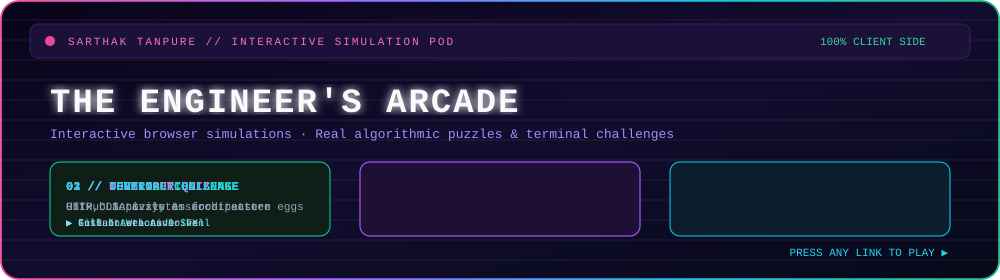

<div align="center">

  <!-- Hero Header Banner -->
  <a href="#command-center">
    
  </a>

  <!-- Animated Typing Subtitle -->
  <a href="https://github.com/Sarthaktanpure">
    
  </a>

  <!-- Telemetry Metadata Badges -->
  <p align="center">
    
    
    
    
  </p>

  <!-- Connect & Dispatch Links -->
  <p align="center">
    <a href="https://www.linkedin.com/in/sarthak-tanpure-a74b5133a">
      
    </a>
    <a href="https://github.com/Sarthaktanpure">
      
    </a>
    <a href="mailto:sarthaktanpure255@gmail.com">
      
    </a>
    <a href="https://my-portfolio-five-phi-26.vercel.app/">
      
    </a>
    <a href="https://webcraftstudioofficial.online">
      
    </a>
  </p>

  <!-- Quick Anchor Navigation -->
  <p align="center">
    <code><a href="#command-center">01 // COMMAND CENTER</a></code> &nbsp;•&nbsp;
    <code><a href="#technology-arsenal">02 // TECH ARSENAL</a></code> &nbsp;•&nbsp;
    <code><a href="#featured-projects">03 // FEATURED BUILDS</a></code> &nbsp;•&nbsp;
    <code><a href="#engineers-arcade">04 // THE ARCADE</a></code> &nbsp;•&nbsp;
    <code><a href="#activity-telemetry">05 // TELEMETRY</a></code> &nbsp;•&nbsp;
    <code><a href="#engineering-timeline">06 // TIMELINE</a></code> &nbsp;•&nbsp;
    <code><a href="#dispatch-connect">07 // CONTACT</a></code>
  </p>

</div>


<a id="command-center"></a>

## `>_` Engineering Command Center

<table>
<tr>
<td width="58%" valign="top">

```console
$ whoami
Sarthak Tanpure — Software Engineer based in India [19.53° N, 74.65° E]
Third-year B.Tech IT @ Pravara Rural Engineering College (PREC Loni) · CGPA: 9.0/10

$ cat developer_profile.json
{
  "identity": "Software Engineer · Backend Systems · Full-Stack · Applied AI",
  "mission": "Engineering dependable software that solves real operational bottlenecks",
  "core_focus": [
    "High-throughput RESTful APIs & telemetry",
    "Scalable multi-tenant full-stack platforms",
    "Explainable AI computer-vision pipelines"
  ],
  "problem_solving": "200+ Java Data Structures & Algorithms solved",
  "venture": "Co-Founder @ WebCraft Studio (End-to-End Client Architecture)",
  "open_to": ["SDE Internships", "Backend Engineering", "Open Source Collaboration"]
}

$ ./sysinfo --telemetry
Architectural approach: Grounded in real-world dependability. I build where the API
meets the storage layer — turning complex workflows into resilient, measurable systems.
```
</tr>
</table>


<a id="technology-arsenal"></a>

## `~/arsenal` — Technology Ecosystem

<p align="center">
  <a href="#technology-arsenal">
    
  </a>
</p>

<table width="100%">
  <thead>
    <tr>
      <th align="left" width="22%">Domain</th>
      <th align="left" width="48%">Core Technologies</th>
      <th align="left" width="30%">Architectural Role</th>
    </tr>
  </thead>
  <tbody>
    <tr>
      <td><b>Languages</b></td>
      <td><code>Java</code> <code>JavaScript (ES6+)</code> <code>TypeScript</code> <code>Python</code></td>
      <td>DSA, OOP architecture, type safety, ML &amp; scripting</td>
    </tr>
    <tr>
      <td><b>Backend Engineering</b></td>
      <td><code>Node.js</code> <code>Express.js</code> <code>FastAPI</code> <code>RESTful APIs</code> <code>JWT Auth</code> <code>Bcrypt</code></td>
      <td>High-throughput web services, RBAC auth, micro-routing</td>
    </tr>
    <tr>
      <td><b>Frontend Engineering</b></td>
      <td><code>React 19</code> <code>Vite</code> <code>Tailwind CSS</code> <code>HTML5</code> <code>CSS3</code> <code>Responsive UI</code></td>
      <td>Component architecture, state management, SPA performance</td>
    </tr>
    <tr>
      <td><b>Databases &amp; Caching</b></td>
      <td><code>MongoDB</code> <code>Mongoose ODM</code> <code>Redis (Basics)</code> <code>JSON B-Trees</code></td>
      <td>Document modeling, indexing, aggregation pipelines, caching</td>
    </tr>
    <tr>
      <td><b>Applied AI &amp; ML</b></td>
      <td><code>Deep CNNs</code> <code>Grad-CAM Heatmaps</code> <code>OpenCV (CLAHE)</code> <code>PyTorch (Basics)</code></td>
      <td>Medical imaging triage, image enhancement, explainable AI</td>
    </tr>
    <tr>
      <td><b>Tools &amp; Cloud Ops</b></td>
      <td><code>Git</code> <code>GitHub Actions</code> <code>Postman</code> <code>Linux (WSL/Ubuntu)</code> <code>Vercel</code> <code>Render</code></td>
      <td>Version control, automated CI/CD workflows, edge deployment</td>
    </tr>
  </tbody>
</table>


<a id="featured-projects"></a>

## `~/projects` — Featured Engineering Builds

Each project represents a production-minded build with verified architecture, real code implementations, and working deployments.

---

<a id="01-api-sentinel"></a>

### 01 / API Sentinel — Observability & Telemetry Platform `[NEWEST RELEASE]`

<div align="center">
  <a href="https://github.com/Sarthaktanpure/Api-Sentinel">
    
  </a>
</div>

<table>
<tr>
<td width="65%" valign="top">

**A full-stack API monitoring and health-tracking platform that enables engineering teams to observe endpoint availability, record live latency metrics, detect unexpected status codes, and retain complete diagnostic histories.**

* **Centralized Endpoint Hub**: Register and configure mission-critical APIs with custom check frequencies and payloads.
* **Telemetry & Latency Engine**: Measures request round-trip time (RTT), response sizes, and HTTP status codes in real time.
* **Historical Health Auditing**: Stores structured logs in MongoDB for inspection of downtime incidents, latency spikes, and uptime percentages.
* **Failure Alert Detection**: Flags degrading services before catastrophic outages occur.

</td>
<td width="35%" valign="top">

```yaml
system: API Sentinel
status: Production Ready
stack:
  frontend: React, Vite, Axios
  backend: Node.js, Express.js
  database: MongoDB, Mongoose
  telemetry: HTTP RTT Engine
role: Creator & Architect
repo: Sarthaktanpure/Api-Sentinel
```

<div align="center">
  <a href="https://github.com/Sarthaktanpure/Api-Sentinel">
    
  </a>
</div>

</td>
</tr>
</table>

---

<a id="02-hospitalos"></a>

### 02 / HospitalOS — Clinical Healthcare ERP & Operations System

<div align="center">
  <a href="https://hospital-os-black.vercel.app">
    
  </a>
</div>

<table>
<tr>
<td width="65%" valign="top">

**A comprehensive, multi-role hospital management system designed to eliminate clinical paperwork and orchestrate hospital operations through dedicated role-based portals.**

* **Multi-Role RBAC Matrix**: Dedicated secure portals for Administrators, Doctors, Receptionists, Nurses, Pharmacists, Lab Technicians, and Patients.
* **Clinical Workflow Engine**: Digital prescriptions, appointment scheduling, treatment records, and patient medical history management.
* **Laboratory & Pharmacy Integration**: Tracks diagnostic lab orders, pharmacy inventories, and dispense authorizations.
* **Enterprise Security**: JWT-protected authentication, encrypted session handling, and granular authorization middleware.

</td>
<td width="35%" valign="top">

```yaml
system: HospitalOS
status: Live on Vercel
stack:
  frontend: React 19, Tailwind CSS
  backend: Node.js, Express.js
  database: MongoDB, Mongoose
  auth: JWT, Bcrypt
role: Lead Full-Stack Architect
live: hospital-os-black.vercel.app
```

<div align="center">
  <a href="https://hospital-os-black.vercel.app">
    
  </a>
  <br />
  <a href="https://github.com/Sarthaktanpure/HospitalOS">
    
  </a>
</div>

</td>
</tr>
</table>

---

<a id="03-agriconnect"></a>

### 03 / AgriConnect — Peer-to-Peer Agricultural Marketplace

<div align="center">
  <a href="https://agriconnect-ohet.vercel.app/listings">
    
  </a>
</div>

<table>
<tr>
<td width="65%" valign="top">

**A full-stack agricultural commerce platform connecting farmers directly with commercial buyers, eliminating predatory middlemen and establishing transparent produce trade.**

* **Direct Farmer Listings**: Farmers create, edit, and manage crop inventory with yield specifics, harvest dates, and base pricing.
* **Commercial Buyer Discovery**: Buyers filter commodities by location, quantity, and pricing with direct inquiry capabilities.
* **Zero Middleman Protocol**: Prevents unfair markup by allowing direct peer-to-peer transaction transparency.
* **Decoupled Architecture**: High-speed React/Vite client deployed to Vercel paired with a robust REST API backend deployed on Render.

</td>
<td width="35%" valign="top">

```yaml
system: AgriConnect
status: Live on Vercel & Render
stack:
  frontend: React, Vite, Tailwind CSS
  backend: Node.js, Express.js
  database: MongoDB, Mongoose
  security: JWT Authentication
role: Full-Stack Developer
live: agriconnect-ohet.vercel.app
```

<div align="center">
  <a href="https://agriconnect-ohet.vercel.app/listings">
    
  </a>
  <br />
  <a href="https://github.com/Sarthaktanpure/Agriconnect">
    
  </a>
</div>

</td>
</tr>
</table>

---

<a id="04-medvision-ai"></a>

### 04 / MediVision AI — Radiology Triage & Explainable AI

<div align="center">
  <a href="https://med-vision-ai-green.vercel.app">
    
  </a>
</div>

<table>
<tr>
<td width="65%" valign="top">

**An applied AI medical diagnostic platform assisting healthcare professionals with computer-vision triage on CT, MRI, and X-ray imaging using explainable AI heatmaps.**

* **Multi-Modal Scan Ingestion**: Handles CT, MRI, and chest X-rays with interactive slice viewing and zoom inspection.
* **Pre-Processing Pipeline**: Applies OpenCV CLAHE (Contrast Limited Adaptive Histogram Equalization) and noise-reduction filters.
* **Explainable AI (Grad-CAM)**: Generates visual saliency heatmaps highlighting the exact anatomical regions responsible for the deep CNN prediction.
* **Automated Clinician Summary**: Produces structured clinical reports with confidence scores (e.g. 96.4%) and diagnostic notes for EHR export.

</td>
<td width="35%" valign="top">

```yaml
system: MediVision AI
status: Live on Vercel
stack:
  frontend: React, TypeScript
  backend: FastAPI, Python
  models: Deep CNNs, Grad-CAM
  vision: OpenCV, NumPy
role: Applied AI & Full-Stack
live: med-vision-ai-green.vercel.app
```

<div align="center">
  <a href="https://med-vision-ai-green.vercel.app">
    
  </a>
  <br />
  <a href="https://github.com/Sarthaktanpure/MedVisionAI">
    
  </a>
</div>

</td>
</tr>
</table>

---

<a id="05-webcraft-studio"></a>

### 05 / WebCraft Studio — Digital Engineering Venture `[CO-FOUNDER]`

<div align="center">
  <a href="https://webcraftstudioofficial.online">
    
  </a>
</div>

<table>
<tr>
<td width="65%" valign="top">

**A web development and digital solutions studio delivering modern web applications, bespoke client architectures, and high-performance digital infrastructure for paying clients.**

* **Venture Leadership**: Co-Founder directing technical architecture, requirements elicitation, and end-to-end project execution.
* **Client Systems Architecture**: Translating commercial business needs into performant, responsive web apps with zero layout shift and sub-second load times.
* **Full-Lifecycle Delivery**: From wireframes and database schemas to edge CDN deployments, SSL certificates, and client handoff.

</td>
<td width="35%" valign="top">

```yaml
venture: WebCraft Studio
status: Operating Studio
role: Co-Founder & Tech Lead
domains:
  - Custom Web Engineering
  - High-Performance UI/UX
  - Cloud Deployment & SEO
url: webcraftstudioofficial.online
repo: Sarthaktanpure/Web-Crafte
```

<div align="center">
  <a href="https://webcraftstudioofficial.online">
    
  </a>
</div>

</td>
</tr>
</table>

<details>
<summary><b>🔍 Expand to View Additional Active Systems (AscendOS, MedGuardAI)</b></summary>
<br />

| System | Focus | Core Stack | Status |
|:---|:---|:---|:---|
| **[AscendOS](https://github.com/Sarthaktanpure/AscendOS)** | Production-minded personal career management & SDE milestone operating system | React 18, Vite, Service Workers, REST API | [Live Demo →](https://ascend-os-rust.vercel.app) |
| **[MedGuardAI](https://github.com/Sarthaktanpure/MedGuardAI)** | Offline-first medicine verification & supply-chain counterfeit detection platform | TypeScript, Node.js, AI/ML, QR verification | In Active Development |

</details>


<a id="engineers-arcade"></a>

## THE ENGINEER'S ARCADE

An interactive simulation suite built directly into this repository. While GitHub READMEs do not execute arbitrary client-side JavaScript, the entire arcade is hosted live as a zero-dependency web app via GitHub Pages (and runs locally in `arcade/index.html`).

<div align="center">
  <a href="https://sarthaktanpure.github.io/Sarthaktanpure/arcade/">
    
  </a>
</div>

<br />

<table>
<tr>
<td width="50%" valign="top">

### 🐍 GitHub Contribution Grid Snake

<div align="center">
  <!-- Live GitHub Actions snake animation from the output branch -->
  <a href="https://github.com/Sarthaktanpure">
    
  </a>
</div>

<p align="center">
  <sub>Generated automatically every 24 hours at <code>00:00 UTC</code> from real GitHub commits via GitHub Actions.</sub>
</p>

</td>
<td width="50%" valign="top">

### 🕹️ Interactive Browser Simulations

Launch the simulations right in your browser with synthesized Web Audio sound FX and Matrix rain visuals:

* **[🧠 Launch Developer Quiz →](https://sarthaktanpure.github.io/Sarthaktanpure/arcade/?game=quiz)**  
  Test your knowledge on RFC 9110 HTTP idempotency, Java HashMap red-black tree collision resolution, MongoDB B-Tree indexing, and Node.js event loops.

* **[💻 Launch Interactive Terminal →](https://sarthaktanpure.github.io/Sarthaktanpure/arcade/?game=terminal)**  
  Simulated Linux shell supporting commands like `help`, `whoami`, `cat profile.json`, `projects`, `ping sentinel`, `dsa`, and secret easter eggs.

* **[🐍 Play Retro Snake Game →](https://sarthaktanpure.github.io/Sarthaktanpure/arcade/?game=snake)**  
  Play the arcade snake game eating glowing neon GitHub commit nodes with keyboard or mobile D-pad controls!

<div align="center">
  <br />
  <a href="https://sarthaktanpure.github.io/Sarthaktanpure/arcade/">
    
  </a>
</div>

</td>
</tr>
</table>


<a id="activity-telemetry"></a>

## `~/telemetry` — Engineering Activity Dashboard

Real-time telemetry and coding activity synchronized with GitHub's developer API:

<div align="center">

  
  &nbsp;
  

</div>

<div align="center">

  

</div>


<a id="engineering-timeline"></a>

## `~/timeline` — Verified Engineering Journey

```diff
@@ 2026 → PRESENT @@  Building Next-Gen Systems & Scaling WebCraft Studio
```
* **Featured Engineering Release**: Designed and launched **API Sentinel**, an observability platform for endpoint health checks and latency telemetry.
* **Venture Scaling**: Co-Founding and scaling **WebCraft Studio**, architecting high-performance web applications and digital infrastructure for paying clients.
* **Algorithmic Rigor**: Practiced over **200+ Java Data Structures and Algorithms** problems across LeetCode and competitive programming tracks (focused on Graphs, Trees, Heaps, and Dynamic Programming).
* **Technical Competition**: Participated in national-level technical competitions including **India Tech Summit: Innovate 2026 Round 2** and hackathons.

```diff
@@ 2025 → 2026 @@  Full-Stack & Applied AI Architecture
```
* **Clinical Platform Engineering**: Architected **HospitalOS**, an enterprise MERN healthcare management platform with multi-tenant RBAC portals and live appointments.
* **Applied AI Healthcare**: Developed **MediVision AI**, implementing CNN-based medical image triage with Grad-CAM visual explainability heatmaps on CT/MRI/X-ray scans.
* **Agricultural Marketplace**: Shipped **AgriConnect**, connecting agricultural producers directly to buyers with decoupled Vercel & Render cloud deployments.

```diff
@@ 2022 → 2026 @@  B.Tech in Information Technology — Pravara Rural Engineering College
```
* **Academic Excellence**: Maintaining a cumulative **9.0 / 10 CGPA** in Information Technology at Pravara Rural Engineering College (PREC Loni, Ahmednagar, Maharashtra).
* **Core Foundation**: Computer Networks, Database Management Systems, Operating Systems, Software Engineering, Object-Oriented Programming (Java/C++).


<a id="current-focus"></a>

## `engineering.config.yml` — Live Environment State

```yaml
developer:
  name: "Sarthak Tanpure"
  role: "Software Engineer · SDE Candidate"
  origin: "Rahuri, Ahmednagar, Maharashtra, India"
  education:
    degree: "B.Tech in Information Technology (Year 3)"
    institution: "Pravara Rural Engineering College, Loni"
    standing: "9.0 / 10 CGPA"

currently_building:
  - "API Sentinel — Advanced latency telemetry & scheduled endpoint health checks"
  - "High-throughput distributed backend architectures with caching & message queues"
  - "Client web infrastructure & digital products through WebCraft Studio"

learning_and_mastering:
  - "Advanced Java Data Structures & Algorithms (200+ Solved & expanding)"
  - "Low-Level Design (LLD) & High-Level System Design (HLD)"
  - "Distributed database sharding, replication & query optimization"
  - "Applied AI integrations with modern cloud backends"

open_to_collaborate:
  - "Software Development Engineer (SDE) Internships"
  - "High-impact Backend & Full-Stack Engineering roles"
  - "Open source developer tooling & systems software"
```


<a id="dispatch-connect"></a>

## `// DISPATCH & CONTACT`

I am actively exploring **Software Development Engineer (SDE) Internships**, collaborative backend initiatives, and high-impact engineering teams. If you are building dependable systems, let's talk.

<div align="center">

  <table align="center">
    <tr>
      <td align="center">
        <a href="https://www.linkedin.com/in/sarthak-tanpure-a74b5133a">
          <br />
          <sub><b>sarthak-tanpure-a74b5133a</b></sub>
        </a>
      </td>
      <td align="center">
        <a href="mailto:sarthaktanpure255@gmail.com">
          <br />
          <sub><b>sarthaktanpure255@gmail.com</b></sub>
        </a>
      </td>
      <td align="center">
        <a href="https://github.com/Sarthaktanpure">
          <br />
          <sub><b>@Sarthaktanpure</b></sub>
        </a>
      </td>
      <td align="center">
        <a href="https://webcraftstudioofficial.online">
          <br />
          <sub><b>webcraftstudioofficial.online</b></sub>
        </a>
      </td>
    </tr>
  </table>

  <br />
  <p>
    <i>"Build with intent. Measure what matters. Keep learning in public."</i>
  </p>
  <br />

  <!-- Animated Footer SVG -->
  <a href="#command-center">
    
  </a>

</div>
